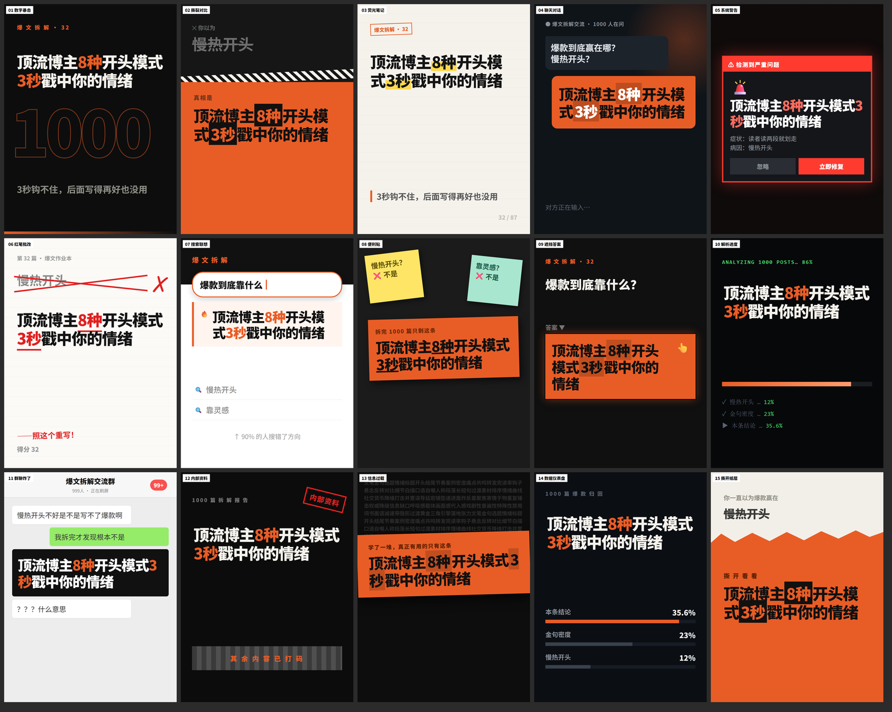

# cover-maker

为你的内容**设计**封面风格，然后批量出图。

不是又一个模板库。模板库的问题是：别人的模板是为别人的题材做的——一套深色工业风放在硬核干货上很带劲，放在亲子号上就是灾难。所以这个项目不预置任何成品风格，它交付的是**一套设计流程**：问清内容和用途 → 推荐几个风格方向 → 现场设计 → 出样张 → 按反馈迭代 → 定稿存成你自己的模板 → 批量生产。

模板库初始是空的，这是故意的。

## 它能做出什么



上图是用这套流程为一个内容创作类账号设计的 15 套风格，**同一个标题**出的 15 张封面。

注意它们的差异不在配色，在**结构**：巨型数字做背景水印、上下撕裂对比、纸面荧光笔记、聊天气泡、系统警告弹窗、红笔批改作业、搜索下拉联想、便利贴排除法、遮挡答案、终端解析日志、群聊 99+、盖章内部资料、信息噪音墙、数据仪表盘、撕开纸层。

每一套里标题都是第一个被读到的东西，但承载它的形式完全不同——这是本项目最在意的一件事，详见[设计方法论](references/design-guide.md)。

> 这 15 套是**示例产出，不是内置模板**。它们为那个账号的题材服务（眉标写着"爆文拆解"、噪音墙是写作术语），换个账号就该重新设计。项目本身不预置任何成品风格。

## 它能做什么

- **从标题出图** —— 一句话出一张封面
- **从文章出图** —— 丢一篇 md/txt 或整个目录，自动提取标题批量出图
- **多种比例** —— 小红书首图 3:4、短视频封面 9:16、方图 1:1、横版 16:9、公众号头图 2.35:1，也可自定义像素
- **自己的模板库** —— 定稿的风格存成 HTML 模板，之后反复复用、多套轮转
- **零服务依赖** —— 只要 Python 和系统自带的浏览器，不联网、不要 API key

## 两种用法

### 一、作为 AI agent 的 skill（推荐）

这是它的设计初衷。把目录放进 agent 的 skill 目录，然后直接说"帮我设计封面"：

```
# Kiro
<workspace>/.kiro/skills/cover-maker/

# Claude Code 等支持 skill 的 agent
~/.agents/skills/cover-maker/
```

agent 读 `SKILL.md` 拿到六步流程，会先问你用途、比例、调性，给几个风格方向，再动手设计、出样张、按你的反馈改。设计判断写在 `references/design-guide.md` 里。

### 二、作为独立的封面批量生成器

不需要 agent 也能用——自己写模板，拿它当批量出图工具：

```powershell
cd scripts
py -3 doctor.py                          # 自检
py -3 cover.py --new 我的风格 --size 3:4   # 生成空白模板，自己填 HTML/CSS
py -3 cover.py -t "标题" -s 我的风格        # 出图
```

模板就是普通 HTML + CSS，规范见 `references/template-spec.md`。

## 快速开始

### 环境

| 需要 | 说明 |
|---|---|
Python 3.7+ | 标准库就够，无第三方依赖 |
Edge 或 Chrome | 用于无头截图，Windows 自带 Edge |
中文字体 | Windows 自带微软雅黑；macOS/Linux 需有苹方或思源黑体 |

```powershell
cd scripts
py -3 doctor.py
```

全绿即可开工。模板库为空时会提示——这是正常的初始状态。

### 出第一张图

模板库是空的，先要有一套风格。让 agent 设计，或者自己来：

```powershell
# 1 生成空白模板
py -3 cover.py --new 我的风格 --size 3:4

# 2 编辑它（在你工作目录的 cover-templates/ 下），写入 CSS 和 HTML
#   最少只要让标题出现：<div class="hero">{{title_html}}</div>

# 3 出图
py -3 cover.py -t "新手最容易踩的5个坑" -s 我的风格
```

默认输出到 `covers/`，文件名就是标题。

## 命令参考

```powershell
# 出图
py -3 cover.py -t "标题" -s 风格名              # 单个标题
py -3 cover.py -a 文章.md -s 风格名             # 一篇文章，自动取标题
py -3 cover.py -a 文章目录 -s 风格名            # 整个目录批量
py -3 cover.py -f titles.txt -s 风格名          # 标题清单，一行一个
py -3 cover.py -t "标题" --all                 # 每套模板各出一张，挑风格用
py -3 cover.py -a 文章目录 --all               # 批量时多套风格轮转

# 模板管理
py -3 cover.py --list                          # 看现有模板
py -3 cover.py --new 风格名 --size 3:4          # 新建空白模板
py -3 cover.py --sizes                         # 看画布预设

# 其他
py -3 doctor.py                                # 环境 + 模板自检
py -3 cover.py -o D:\covers                    # 指定输出目录
py -3 cover.py --templates D:\my-templates     # 指定模板目录
```

可选精调参数（不填会从标题自动推断）：`--key` 核心词、`--wrong` 对立面、`--num` 数字、`--seq`/`--total` 连载序号、`--query` 问句。

## 模板怎么写

一个模板 = 一个 `.html` 文件，三部分：

```html
<!-- cover-template
     name: 风格名
     size: 3:4
     note: 适合什么内容
-->
<style>
  #root { background: #16181D; }
  /* 你的版式 CSS。#root 已有画布尺寸和 position:relative */
</style>

<div class="hero">{{title_html}}</div>
```

渲染时跑在无头 Chromium 里，现代 CSS 基本都能用：渐变、`clip-path`、`transform`、`filter`、`mix-blend-mode`、伪元素、内联 SVG。不能用外部资源（网络字体、远程图片）和 JS。

### 可用占位符

以标题「新手最容易踩的5个坑：第3个最致命」为例：

| 占位符 | 内容 | 例 |
|---|---|---|
`{{title}}` | 纯文本标题 | `新手最容易踩的5个坑：第3个最致命` |
`{{title_html}}` | 标题，数字自动包上 `class="o"` 的 span | 给 `.o` 一个颜色就有数字高亮 |
`{{head}}` / `{{tail}}` | 冒号前 / 后 | `新手最容易踩的5个坑` / `第3个最致命` |
`{{key}}` | 核心词 | `坑` |
`{{num}}` | 第一个数字 | `5` |
`{{wrong}}` | 对立面/错误认知 | 需 `--wrong` 指定 |
`{{seq}}` / `{{total}}` | 连载序号 | `01` / `10` |
`{{query}}` | 问句 | 需 `--query` 指定 |
`{{hero_px}}` | 建议字号（纯数字） | `98` |

占位符是纯文本替换，不执行逻辑。写错名字不报错，会原样留在画面上——`doctor.py` 会把这种情况报出来。

### 模板放在哪

查找顺序：`--templates` 指定 → 环境变量 `COVER_TEMPLATES` → **当前工作目录的 `cover-templates/`**（默认）→ 项目自带的 `templates/`（只有格式说明文件）。

默认放工作目录是有意的：不同账号、不同项目的风格不该混在一起，升级项目也不会覆盖你的模板。文件名以 `_` 开头视为草稿，不进模板列表。

## 设计方法论

`references/design-guide.md` 是这个项目的核心资产，不是工具文档。里面有：

- **两条铁律** —— 标题必须第一个被读到；但"标题第一"不等于"居中大字"
- **多样性硬约束** —— 怎么保证几套方案不是同一套的几种配色（黑白测试、结构描述测试）
- **六个脑洞维度** —— 载体隐喻 / 界面仿真 / 物理材质 / 信息图式 / 破坏反常 / 拼贴剪报，每个维度带具体方向清单
- **规则的硬软边界** —— 哪四条是物理约束不能破，哪些只是默认建议、什么时候该破
- **反馈对照表** —— 用户说"太素了""像广告""不够抓人"，分别该动什么

一条摘录，说明这个项目在意什么：

> **"标题第一"说的是信息层级，不是版式形状。** 标题可以被包在对话气泡里、写在便利贴上、做成搜索结果的命中项、嵌进系统弹窗、压在撕开的纸层下面——只要它是画面上第一个被读到的东西，承载它的形式可以千变万化。

## 项目结构

```
SKILL.md                      给 agent 的六步工作流程
references/
  design-guide.md             设计方法论：铁律、多样性约束、脑洞维度、反馈对照
  template-spec.md            模板文件规范：元数据、占位符、CSS 约定、调试
scripts/
  cover.py                    命令行入口
  core.py                     画布预设、标题/文章解析、数字高亮、字号自适应
  registry.py                 模板扫描、元数据解析、渲染
  render.py                   HTML 包装、无头截图
  doctor.py                   环境与模板自检
templates/
  _文件格式说明.html            演示模板文件由哪几块组成（不是风格示例）
assets/
  titles.example.txt          标题清单格式示例
docs/
  example-15-styles.png       示例产出：同一标题 × 15 种结构
```

## 产出规格

- 尺寸由模板的 `size` 决定，预设 `3:4` `9:16` `1:1` `16:9` `2.35:1`，也可写 `1242x1660`
- PNG，文件名 = 标题（自动去掉 `\ / : * ? " < > |`）
- 速度约每张 1.5 秒（每张起一次无头浏览器），几十篇以上建议后台跑

## 常见问题

**出图 FAIL**
找不到浏览器。中文路径已处理（先截 ASCII 临时路径再改名），若仍失败用 `--browser` 指定 Edge/Chrome 路径。

**封面上出现 `{{xxx}}` 字样**
占位符名拼错了。跑 `py -3 doctor.py`，它会指出是哪套模板。

**字显示成方框**
系统缺中文字体。

**几套方案看起来都一样**
只换了配色没换结构。看 `design-guide.md` 的「多样性硬约束」，用黑白测试复查。

## License

MIT
